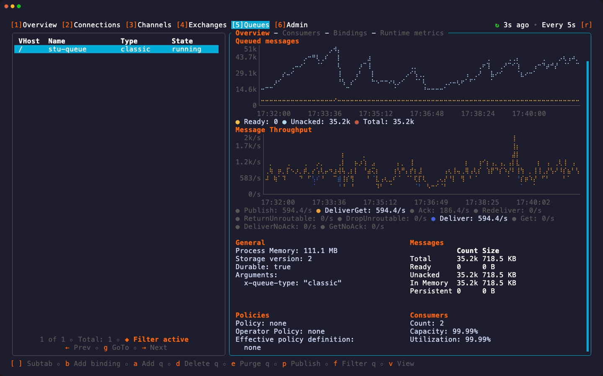

<div align="center">

# trabbit

[](https://github.com/jadegopher/trabbit/actions/workflows/ci.yml)
[](go.mod)
[](https://github.com/jadegopher/trabbit/releases)
[](LICENSE)

[Install](#install) · [Connect](#connect) · [Contribute](CONTRIBUTING.md)

</div>

**RabbitMQ administration, right in your terminal.**




A TUI for administering RabbitMQ, built as an alternative to the management web
UI. Inspect queues, watch traffic and publish messages without leaving your
terminal.

**Early days:** `trabbit` currently covers the **Queues** tab. The other management
tabs are placeholders. I plan to add more as people show interest or I need more
functionality myself. Have something in mind? [Open an issue](https://github.com/jadegopher/trabbit/issues).

## What you can do

- **Manage queues** — create, delete and purge; filter by name, regex or virtual host.
- **Watch live activity** — message counts, throughput charts, consumers, bindings
  and runtime statistics, with configurable refresh and chart settings.
- **Publish comfortably** — a full-screen payload editor with JSON beautification,
  text selection, undo/redo, and editable message properties and headers.
- **Use keys or a mouse** — click to focus and select, scroll panels, and drag to
  select text in the editor. Contextual shortcuts keep actions close at hand.

## Install

With [Go](https://go.dev/dl/) installed:

```sh
go install github.com/jadegopher/trabbit/cmd/trabbit@latest
```

Or download a binary for your OS and architecture from
[GitHub Releases](https://github.com/jadegopher/trabbit/releases).

To build from source:

```sh
git clone https://github.com/jadegopher/trabbit.git
cd trabbit
mise install
mise exec -- go build -o trabbit ./cmd/trabbit
```

## Connect

Start `trabbit` for the login form, or connect directly:

```sh
trabbit --url 'http://localhost:15672' --user guest --pass guest
```

Use the RabbitMQ **management HTTP(S) endpoint**, usually port `15672`. The
[management plugin](https://www.rabbitmq.com/docs/management) must be enabled.
See [CLI usage](docs/cli.md) for connection options, or run `trabbit --help`.

On the Queues tab, `a` adds a queue, `f` filters, and `p` opens the publisher.
Use `Tab` to switch panels and `[` / `]` to cycle detail tabs. In the payload
editor, `Ctrl+B` beautifies JSON, `Ctrl+G` opens editing help, and `F5` publishes.
Press `Ctrl+C` twice in a row to quit.

---

Built with [Go](https://go.dev/) and [Bubble Tea](https://github.com/charmbracelet/bubbletea).
Contributions are welcome — see [CONTRIBUTING.md](CONTRIBUTING.md).
Licensed under [MIT](LICENSE).
